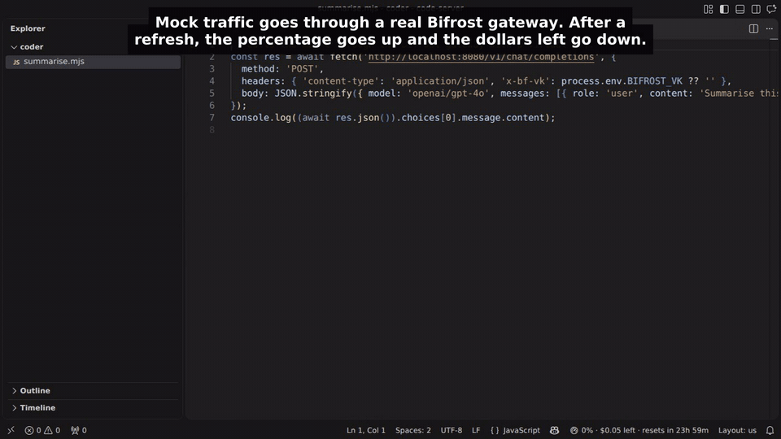
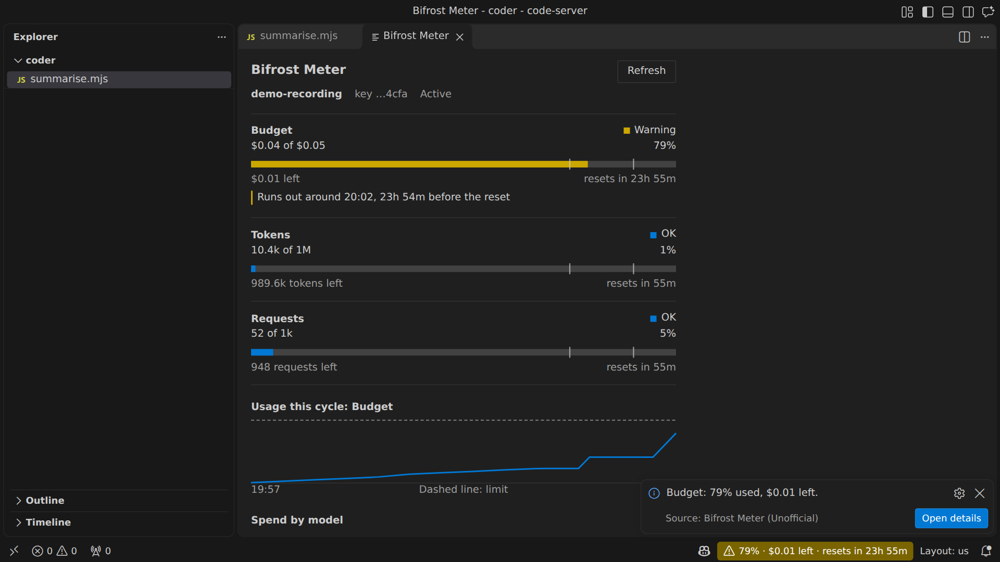

# Bifrost Meter (Unofficial)

A VS Code extension that shows the remaining budget and rate limits of your Bifrost virtual key in the editor status bar.

> **Unofficial.** This project is not affiliated with, endorsed by, or supported by Maxim AI or the Bifrost project.
> It reads only the public, documented quota endpoint of an unmodified Bifrost gateway.

| OK | Warning | Used up |
| --- | --- | --- |
|  |  |  |

Built for the Global AI Hackathon (Geek Room), problem statement PS04 "Open-Source Bifrost Gateway".

**Try it:** `demo/run.sh` (needs Docker) starts a pinned Bifrost gateway with a labelled mock upstream, demo keys, mock
traffic and an editor in your browser with the meter already connected. See [demo/README.md](demo/README.md).

**Status:** work in progress. Install steps and test results will be added here as they land.

## For agents

The extension also carries a small MCP server with one read-only tool, `get_budget_status`, so a coding agent can read the
same budget and limits before a long task. VS Code 1.101 and later list it automatically; other MCP clients can start
`node dist/mcp.js`. Setup, output and an example `AGENTS.md` snippet: [docs/MCP.md](docs/MCP.md).

## AI disclosure

AI disclosure: the code, tests and documentation in this repository were written by AI coding agents (Anthropic Claude models)
working under my direction. I chose the problem, set the requirements and checked the result in the demo. I am responsible for it.

## License

Apache-2.0. See [LICENSE](LICENSE).
