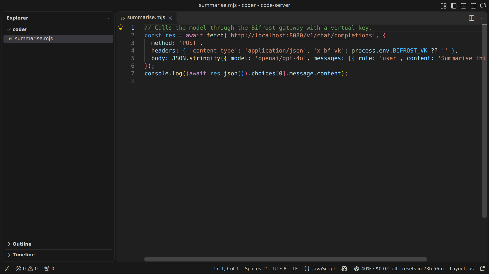
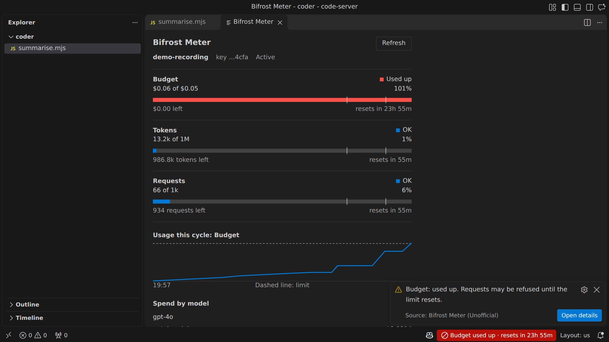

# Bifrost Meter (Unofficial)

See what is left on your Bifrost virtual key without leaving the editor.

[](https://github.com/aimanmalib/bifrost-meter/actions/workflows/ci.yml)


Bifrost enforces budgets and rate limits per virtual key. An admin can watch them in the dashboard. The developer who holds
the key cannot, and usually finds out when a request is refused.

Bifrost Meter reads the gateway's own self-service quota endpoint with the key you already have. It keeps the answer in the
VS Code status bar, warns at 75% and 90%, and estimates when the budget runs out. A small MCP server gives coding agents the
same numbers, so an agent can check before it starts a long task.

> **Unofficial.** Not affiliated with, endorsed by, or supported by Maxim AI or the Bifrost project. It talks to an unmodified
> Bifrost gateway through one documented endpoint and changes nothing on it.

Built for the Global AI Hackathon (Geek Room), problem statement PS04, "Open-Source Bifrost Gateway". Slides: [`docs/deck.pdf`](docs/deck.pdf). The
full 87-second narrated demo video is attached to the [latest release](https://github.com/aimanmalib/bifrost-meter/releases/latest).

| OK | Warning | Used up |
| --- | --- | --- |
|  |  |  |

## Already run Bifrost? Two steps

1. Download `bifrost-meter.vsix` from the [Releases page](https://github.com/aimanmalib/bifrost-meter/releases) and install it:
   `code --install-extension bifrost-meter.vsix` (or Extensions view, `...` menu, **Install from VSIX...**).
2. Run **Bifrost Meter: Set Virtual Key** from the Command Palette and paste your key. If the gateway is not at
   `http://localhost:8080`, also run **Bifrost Meter: Set Gateway URL**.

The status bar item shows how much of the closest limit is used. Click it for the details panel. You need Bifrost v1.5.0 or
newer and VS Code 1.90 or newer. You do not need admin access. More in [`docs/INSTALL.md`](docs/INSTALL.md).

## No gateway yet? One command

```sh
demo/run.sh          # needs Docker only
demo/run.sh stop     # removes every demo container and all gateway data
```

`demo/run.sh` starts a pinned, unmodified Bifrost gateway, a mock model upstream labelled `[mock]`, two demo keys, steady
mock traffic, and an editor in your browser with Bifrost Meter already connected. Open the printed link; the meter is in the
status bar without typing anything. The demo key has a $1.00 budget that resets every 5 minutes, so within about 5 minutes
the meter goes from OK to a warning at 75%, critical at 90%, "Budget used up" and back to OK after the reset. No provider
account and no paid API call. Every port is bound to `127.0.0.1`. If
8080 or 8443 is taken, as 8080 usually is on a machine that already runs Bifrost, the script uses the next free port and
prints it. To run the stack step by step with your own editor, see [`demo/README.md`](demo/README.md).

## The problem, from an operator

An operator described this gap in the Bifrost issue tracker on 24 August 2026
([issue 6482](https://github.com/maximhq/bifrost/issues/6482)):

> "Those callers need to see their own spend and remaining budget in lightweight clients such as a Windows tray usage
> monitor, without receiving management-plane credentials or access to other tenants' logs."

The same issue names the endpoint this extension uses and says it "is safely authenticated by the Virtual Key itself".
Bifrost Meter is that lightweight client, in the place developers already look.

## What Bifrost already has, and prior art

The problem statement asks contributors to check existing functionality first. This is what I found on 14 November 2026.

| Where | What it does | Why it does not cover this |
|---|---|---|
| Bifrost dashboard | Shows budgets and usage per virtual key | Needs management access. A developer with only a virtual key cannot open it |
| `GET /api/governance/virtual-keys/quota` (since v1.5.0) | Returns the key's own budgets and rate limits to whoever holds the key | It is an endpoint, not a client. Nothing calls it for you or warns you |
| Bifrost CLI | Has a quota operation for virtual keys | One reading in a terminal, when you ask for it |
| [Open pull request 8927](https://github.com/maximhq/bifrost/pull/8927) by the Bifrost team | Adds "users/me/limits" endpoints, "so users and admins can see their budgets, rate limits, and live usage over the API" | Enterprise only, and still an API without an editor client |
| "Bifrost for GitHub Copilot (Unofficial)" on the VS Code Marketplace | Registers Bifrost as a model provider for Copilot Chat | Does not show budgets or limits |
| [bifrost-budget](https://github.com/Jasonrve/bifrost-budget), [bifrost-usage-dashboard](https://github.com/arashfarahani/bifrost-usage-dashboard) | A read-only MCP server and a web dashboard for Bifrost budgets | Separate services, outside the editor |

I found no editor extension that shows a virtual key's budget. The VS Code Marketplace returns 10 extensions for "bifrost"
and Open VSX returns 4; none of them shows usage or budgets. GitHub repository searches for "bifrost vscode" (11 results)
and "bifrost budget" (14 results) found no editor client, and code search for `"virtual-keys/quota" vscode` found none.

## Features

- **Status bar.** Percent used and amount left of the tightest limit (budget, tokens or requests), with the reset time. It
  turns to the warning colour at 75% and the error colour at 90%. Problems have their own text, such as "Set Bifrost key",
  "Key rejected", "Key expired" and "Gateway offline".
- **Tooltip and details panel.** Every budget and rate limit with its reset, spend per model sorted by cost, a small usage
  chart, the run-out estimate, and the gateway version.
- **Warnings.** One notification per threshold per reset cycle, and one per cycle when the estimate says the limit runs out
  before it resets.
- **Admin overrides.** When an admin grants an extra amount on a budget, the meter shows the limit the gateway enforces, not
  the base one.
- **Reset times as the gateway counts them.** A rolling month is 30 days and a quarter 90, as in Bifrost. Keys that are
  calendar aligned reset at 00:00 UTC on the next day, Monday, first of the month, quarter or year.
- **Key safety.** The key lives in the editor's secret storage and is shown only as its last 4 characters. Plain `http://` is
  refused for anything but loopback and private addresses unless you allow it.
- **English and Malay.** Every string comes from the language files; the language follows the editor or the
  `bifrostMeter.language` setting.

Settings (`bifrostMeter.*`: gateway URL, poll interval, thresholds, status bar metric and format, forecast window,
notifications, language) are listed in [`docs/CONFIGURATION.md`](docs/CONFIGURATION.md).

## For agents

The extension also carries a small MCP server with one read-only tool, `get_budget_status`, so a coding agent can read the
same budget and limits before a long task. VS Code 1.101 and later list it automatically; other MCP clients can start
`node dist/mcp.js`. Setup, real output and an example `AGENTS.md` snippet: [`docs/MCP.md`](docs/MCP.md).

## How it works

```
 VS Code / code-server                                   Bifrost gateway (unmodified)
+--------------------------------------------+          +-------------------------------+
| src/extension                              |          |                               |
|  poller --> controller --> view/tooltip    |  x-bf-vk |  GET /api/governance/         |
|     ^           |       \-> panelHtml      | -------> |      virtual-keys/quota       |
|     |           v       \-> notifications  |  <------ |  (budgets, rate limits,       |
|  settings   src/core                       |   JSON   |   spend per model)            |
|  secrets     client -> schema -> model     |          |                               |
|              forecast, format, i18n        |  no key  |  GET /api/version             |
|                                            | -------> |                               |
+--------------------------------------------+          +-------------------------------+
```

`src/core` knows the gateway and has no VS Code import, so the MCP server reuses it. The meter makes one read per editor
window every 60 seconds by default, four times less often while the window is not focused. Details in
[`docs/ARCHITECTURE.md`](docs/ARCHITECTURE.md); the response fields it relies on in [`docs/API-CONTRACT.md`](docs/API-CONTRACT.md).

## PS04 requirements

| Requirement | How this project meets it |
|---|---|
| Real operator problem, end to end | Developers using coding agents through a Bifrost virtual key cannot see their remaining budget until a request is refused (issue 6482 above). The demo goes from `demo/run.sh` to a meter moving in the status bar |
| Public extension points | Only the documented self-service endpoint `GET /api/governance/virtual-keys/quota`, plus an MCP server for agents. No change to Bifrost code, no fork |
| Reproducible integration on a standard installation | The official `maximhq/bifrost` image, unmodified and pinned by digest; one-command demo; tested versions listed below |
| Contribution quality | A tested change to the gateway itself, open as [pull request 10044](https://github.com/maximhq/bifrost/pull/10044): the quota response reports the enforced budget limit. Unit tests, contract tests against a real Bifrost container, end-to-end tests in the editor; docs; Apache-2.0 like Bifrost; [`docs/UPSTREAMING.md`](docs/UPSTREAMING.md) on moving it upstream, with three additive fields the quota response could carry, found while building this client |

## Tested with

| Part | Version |
|---|---|
| Bifrost gateway | `v2.5.1`, `maximhq/bifrost@sha256:5ec9873acaf1687556b6e4dd854b92b539d9debf87a5a683b66338648b84d3c8` |
| Editor | code-server `4.145.2` (end to end); compiled against the VS Code 1.90 API (`engines.vscode` `^1.90.0`) |
| Build | Node.js 22, TypeScript, esbuild, `@vscode/vsce` |

## Tests

| Suite | Command | Latest result |
|---|---|---|
| Lint, type check, unit tests, build, package | `npm run gate` | 378 passed, `.vsix` 245 KB |
| Contract, against the pinned gateway in Docker | `npm run test:contract` | 11 passed |
| End to end, Playwright driving code-server | `npm run test:e2e` | 9 passed |

The contract suite also reads the quota endpoint 200 times in a row: p50 6.9 ms, p95 12.2 ms. Two more runs on
the same shared host measured p50 7.1 ms, p95 51.3 ms and p50 6.8 ms, p95 13.0 ms. What each test checks, with
dates and versions, is in [`docs/TEST-RESULTS.md`](docs/TEST-RESULTS.md). The gate and the contract suite also run on GitHub
Actions for every push ([`.github/workflows/ci.yml`](.github/workflows/ci.yml)).

## Limits and honest notes

- The quota endpoint reports the key's own budgets and rate limits. It does not report budgets set on a team or customer
  above the key. If one of those runs out first, the meter still shows the key's own numbers.
- Counters appear a few seconds after a request (2 to 9 seconds in the contract runs), and the meter polls once a minute by
  default. It is a gauge, not an audit log.
- The quota response has no next reset time and no calendar-aligned flag. The meter derives both from `reset_duration`
  and `last_reset` with the gateway's rules ([`docs/API-CONTRACT.md`](docs/API-CONTRACT.md)).
- The run-out estimate is a straight line through the last 30 minutes of readings. Bursty usage will fool it.
- Tested end to end on one gateway version (v2.5.1, pinned by digest) and one editor build. Other editors built on VS Code
  should load it. I have not tested them.
- Not on the VS Code Marketplace or Open VSX. Install from the `.vsix` file in the release.
- The demo uses a mock model upstream, labelled `[mock]`. The gateway, the keys, the budgets and the counters are real.

## Technologies

TypeScript, the VS Code extension API (status bar, webview, secret storage), esbuild, vitest, Playwright, the official MCP
TypeScript SDK, Docker Compose, the official Bifrost image and code-server.

## How AI is used

- **In the product.** The extension makes no model calls and sends nothing to any AI service. It serves people and agents
  who use models through Bifrost. The MCP tool `get_budget_status` lets a coding agent read its own remaining budget and
  limits. The agent can then stop, ask, or pick a cheaper model before a long task, where today it fails halfway.
- **In the build.** AI coding agents (Anthropic Claude models) wrote the code, the tests, the documentation and the slides.
  Because agents wrote it, I only claim what a test checks. The numbers in this README come from `docs/TEST-RESULTS.md`.

## AI disclosure

AI disclosure: the code, tests and documentation in this repository were written by AI coding agents (Anthropic Claude models)
working under my direction. I chose the problem, set the requirements and checked the result in the demo. I am responsible for it.

In detail: the idea is one of the examples in the problem statement. My agents proposed it and wrote the plan. I approved both,
and I watched the recorded demo before I submitted. The narration in the demo video is an AI clone of my own voice; its music is by Sascha Ende, ende.app (CC BY 4.0). The
agent scene in it replays one recorded session of a coding agent (`demo/agent-session.json`).

## Event

Global AI Hackathon by Geek Room, November 2026, problem statement PS04 "Open-Source Bifrost Gateway".
Malay README: [README.ms.md](README.ms.md).

## License

Apache-2.0. See [LICENSE](LICENSE).
