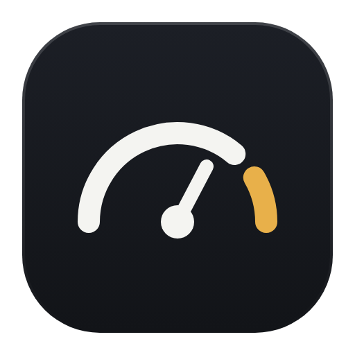
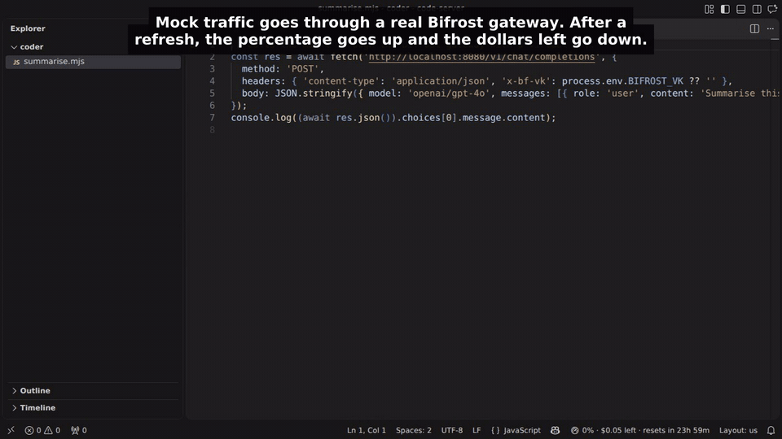

<p align="center"></p>

<h1 align="center">Bifrost Meter (Tidak Rasmi)</h1>

**Lihat baki kunci maya Bifrost anda tanpa meninggalkan editor.**

[Pasang](#sudah-ada-bifrost-dua-langkah) · [Demo satu arahan](#belum-ada-gateway-satu-arahan) ·
[Video, 87 s](https://youtu.be/XpW94Z39lG0) · [Slaid, 12](https://aimanmalib.github.io/bifrost-meter/deck.pdf) · [English](README.md)



Bifrost menguatkuasakan bajet dan had kadar bagi setiap kunci maya. Admin boleh melihatnya di papan pemuka. Pembangun yang
memegang kunci itu tidak boleh, dan biasanya baru tahu apabila permintaan ditolak.

Bifrost Meter membaca titik hujung kuota layan diri gateway itu sendiri dengan kunci yang anda sudah ada. Ia memaparkan
jawapannya di bar status VS Code, memberi amaran pada 75% dan 90%, dan menganggar bila bajet akan habis. Pelayan MCP kecil
memberi ejen pengekod angka yang sama, supaya ejen boleh menyemak sebelum memulakan tugas panjang.

> **Tidak rasmi.** Tidak bergabung dengan, tidak disokong dan tidak disahkan oleh Maxim AI atau projek Bifrost. Ia bercakap
> dengan gateway Bifrost yang tidak diubah melalui satu titik hujung yang didokumenkan, dan tidak mengubah apa-apa padanya.

Dibina untuk Global AI Hackathon (Geek Room), penyataan masalah PS04, "Open-Source Bifrost Gateway". Butiran penuh, ujian
dan had ada dalam [README Inggeris](README.md).

## Sudah ada Bifrost? Dua langkah

1. Dalam editor yang memakai Open VSX (VSCodium, Cursor, code-server), cari "Bifrost Meter" di paparan Extensions
   ([senarai](https://open-vsx.org/extension/aimanmalib/bifrost-meter)). Dalam VS Code, muat turun `bifrost-meter.vsix` dari halaman Releases dan pasang:
   `code --install-extension bifrost-meter.vsix` (atau paparan Extensions, menu `...`, **Install from VSIX...**).
2. Jalankan **Bifrost Meter: Set Virtual Key** dari Command Palette dan tampal kunci anda. Jika gateway bukan di
   `http://localhost:8080`, jalankan juga **Bifrost Meter: Set Gateway URL**.

Item bar status menunjukkan berapa banyak had yang paling hampir sudah terpakai. Klik untuk panel butiran. Anda perlukan
Bifrost v1.5.0 atau lebih baharu dan VS Code 1.90 atau lebih baharu. Akses admin tidak diperlukan.

## Belum ada gateway? Satu arahan

```sh
demo/run.sh          # hanya perlukan Docker
demo/run.sh stop     # buang semua kontena demo dan data gateway
```

`demo/run.sh` menghidupkan gateway Bifrost rasmi yang dipin dan tidak diubah, huluan model tiruan berlabel `[mock]`, dua
kunci demo, trafik tiruan dan editor dalam pelayar dengan Bifrost Meter sudah bersambung. Buka pautan yang dicetak; meter
sudah ada di bar status tanpa menaip apa-apa. Kunci demo ada bajet $1.00 yang diset semula setiap 5 minit, jadi dalam kira-kira
5 minit meter bergerak dari OK ke amaran pada 75%, kritikal pada 90%, "Bajet habis" dan kembali OK selepas set semula. Tiada
akaun pembekal dan tiada panggilan API berbayar. Semua port diikat pada
`127.0.0.1`. Jika port 8080 atau 8443 sudah dipakai (8080 biasanya dipakai pada mesin yang sudah menjalankan Bifrost), skrip
memilih port bebas seterusnya dan mencetaknya. Langkah demi langkah: [`demo/README.md`](demo/README.md).

## Guna

| Arahan (Command Palette) | Fungsi |
|---|---|
| Bifrost Meter: Set Virtual Key | Simpan kunci dalam storan selamat editor (SecretStorage) |
| Bifrost Meter: Clear Virtual Key | Buang kunci yang disimpan |
| Bifrost Meter: Set Gateway URL | Tukar alamat gateway |
| Bifrost Meter: Refresh | Baca kuota sekarang |
| Bifrost Meter: Open Details | Buka panel butiran |
| Bifrost Meter: Copy Summary | Salin ringkasan baki ke papan klip |
| Bifrost Meter: Show Log | Buka log sambungan |

Teks antara muka ada dalam bahasa Inggeris dan Melayu. Bahasa mengikut editor, atau tetapkan `bifrostMeter.language` kepada
`ms`. Tetapan lain (`bifrostMeter.*`: alamat gateway, kekerapan baca, ambang amaran, format bar status, tetingkap ramalan,
notifikasi) diterangkan dalam [`docs/CONFIGURATION.md`](docs/CONFIGURATION.md).

Untuk ejen yang berjalan di terminal, `node dist/cli.js status` mencetak bacaan yang sama sebagai satu baris
(`Bifrost 37% · baki $0.62 · set semula dalam 3m`) untuk baris status atau tmux; butiran dalam [`docs/MCP.md`](docs/MCP.md).

Tiada kotak untuk menaip kunci (sesetengah persekitaran jauh)? Tetapkan pemboleh ubah persekitaran `BIFROST_VIRTUAL_KEY` dan
`BIFROST_BASE_URL` untuk proses editor.

## Bina sendiri

Perlukan Node.js 22.

```sh
npm ci
npm run package      # menulis bifrost-meter.vsix
npm run gate         # lint, semakan jenis, ujian unit, bina dan bungkus
```

## Pendedahan AI

Kod, ujian dan dokumentasi dalam repositori ini ditulis oleh ejen pengekod AI (model Anthropic Claude) di bawah arahan saya.
Saya memilih masalah, menetapkan keperluan dan menyemak hasilnya dalam demo. Saya bertanggungjawab ke atasnya. Sambungan ini
sendiri tidak membuat panggilan model dan tidak menghantar apa-apa ke perkhidmatan AI.

## Lesen

Apache-2.0. Lihat [LICENSE](LICENSE).
